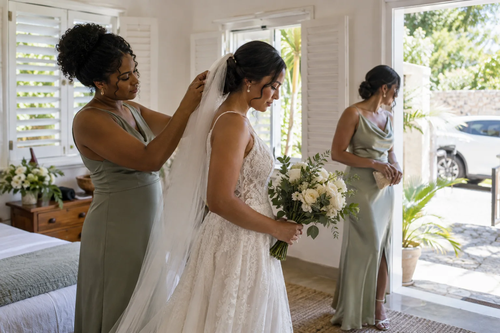

# Barbados wedding getting-ready photos: a coverage timeline that fits the day

*Last updated: October 2026.*

Getting-ready photographs work best when the photographer knows which moments matter, where they will happen, and when everyone must leave for the ceremony. Start from the ceremony arrival deadline and work backward. Reserve time for the final clothing and family moments, allow for travel, and decide whether you want preparation photographed at all. A four-hour wedding collection may require a different choice from a full-day plan.

## How do you work backward from the ceremony?

First confirm the venue's real arrival time and the travel time from the preparation location. Then ask your hair, makeup, dressing, and transport teams when they need you. The photography window must fit around those commitments. A timetable that counts only the ceremony start can leave no space for portraits or a late car.

Here is an **illustrative** sequence measured backward from departure for the ceremony. Replace every interval with the timings supplied by your own vendors and venue.

| Relative moment | Possible photo opportunity | Planning check |
| --- | --- | --- |
| Well before departure | Room, clothing, meaningful details | Are the items together and the room available? |
| After styling is largely complete | Final preparation and candid interactions | Will key people actually be in the room? |
| Before guests or transport need you | Dressing and immediate-family moments | Is there privacy and enough time to pause? |
| Just before departure | Finished portraits and a final check | Can everyone leave on schedule? |

Do not stage a moment solely because it appears in a wedding checklist. If you value a quiet morning more than photographs of every preparation step, say that. The point of the table is to reveal dependencies, not to script how you should feel.

## Which preparation moments are worth prioritizing?

Pick a small number of moments you would regret missing: perhaps a parent helping with clothing, a letter being read privately, or the first time close friends see you ready. Tell the photographer which of those are planned and which should stay spontaneous. A documentary approach can still benefit from knowing that a meaningful event will happen in a particular room at a particular time.

A simple priority note might contain: the people who must appear, the room where the moment will happen, and whether you want it photographed quietly or with a brief portrait afterward. Keep a separate list for details such as rings, clothing, or an heirloom if those objects matter. There is no need to create a long shot list of every brush, button, and toast.

## What should you check about the room and light?

Look at the preparation space at the actual time you expect to use it. A window may give pleasant light in one room and strong glare in another. Ask whether there is space to move near the window, a corner that can stay clear, and an alternative if rain changes the plan. This is a practical review of the room, not a promise about a particular photograph.

If two people are preparing in different locations, include the travel between them. Ask how coverage will be assigned rather than assuming one photographer can photograph two simultaneous moments. JSobersPhotography describes a two-person wedding team, but the exact coverage plan for separate rooms or venues should be agreed for your booking. The [guide to booking from abroad](/blog/how-to-book-a-barbados-wedding-photographer-from-abroad) explains how to bring those logistical questions into the planning call.

## How much of the package should preparation use?

Count preparation against the total coverage window. The [current wedding collections](/wedding-packages) list four hours for Island Bliss, six for Eternal Romance, and up to eight for Signature Experience. If your four hours begin during preparation, fewer hours remain for the ceremony, portraits, and reception. That trade-off is often more important than the number of photographs listed in the collection.

Make two versions of your schedule: one that includes getting ready and one that begins at the ceremony. Compare what each version would miss. For a compact celebration, a few finished portraits before departure may matter more than an hour of preparation coverage. For a longer day, earlier coverage may tell the story more fully. The right choice depends on your priorities, not a universal rule.

Do not rely on an exact sunset time remembered from another wedding. Light and travel are tied to your date and location. The [Barbados venue guide](/blog/barbados-wedding-venues-how-to-choose) offers questions about light, access, and weather that are worth checking with your venue.

## What belongs in the final preparation plan?

One page is enough if it answers the following questions:

1. What time must each person leave for the ceremony?
2. Where is each preparation room, and who can let the team in?
3. Which moments and people are essential to photograph?
4. When are styling, clothing, and transport actually ready?
5. Who will keep personal items and the room organized?
6. What changes if rain or a delay moves the schedule?

Share the final version with the photographer, planner, and relevant vendors. If the plan changes, update one master copy so everyone works from the same times. A useful preparation timeline creates breathing room for the ceremony and portraits that follow; it should never make the morning feel like a series of deadlines invented for the camera. Send your date, venues, and rough sequence to [JSobersPhotography](/contact) to discuss a coverage window that fits.
