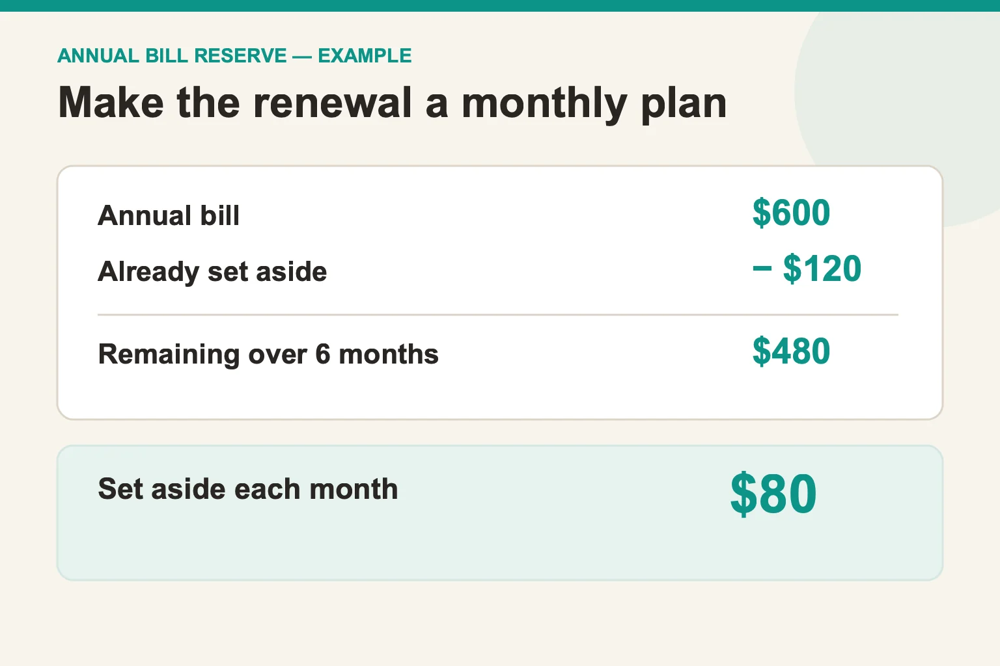

# How to budget for annual household bills without a surprise month

*Last updated: October 2026.*

To budget for an annual household bill, record its next due date and expected amount, then set aside a portion from each payday or month before it arrives. Keep the actual invoice separate from your estimate. Insurance, memberships, and yearly service charges can otherwise disappear from a monthly budget until the payment is due. A calendar shows when the bill lands; a reserve plan shows how you will pay it.

## Which annual bills belong on the list?

Start with bills you are committed to pay, not every possible future purchase. Look through statements, renewal notices, and last year's calendar for annual or less-frequent charges. Record the supplier, due month, expected amount, who pays, and where you can verify the next invoice. If a charge is optional, mark the cancellation or review date as well.

The [Consumer Financial Protection Bureau's bill calendar](https://www.consumerfinance.gov/archive/blog/budget-help-manage-your-monthly-expenses-bill-calendar/) recommends listing bills, amounts, and due dates and checking the calendar regularly. Its [printable calendar guide](https://files.consumerfinance.gov/f/documents/bcfp_your-money-goals_behind-on-bills_booklet_print.pdf) also calls out expenses that come every few months or once a year. These tools are a useful starting point even if you later move your list into an app.

| Record | Why it matters |
| --- | --- |
| Renewal or due date | Shows when cash must be available |
| Last known amount | Gives a starting estimate, not a promise |
| Months or paydays left | Sets the saving pace |
| Current reserve | Shows how much is already set aside |
| Cancellation or review date | Prevents an unwanted renewal from being ignored |

## How much should you set aside each month?

Divide the expected amount by the number of monthly contributions left before payment. For example, an illustrative US$600 bill due in six months needs US$100 a month if nothing has been reserved yet. If you already have US$120 set aside, the remaining US$480 divided by six months is US$80 a month. Use your actual billing amount and dates; this example is a calculation, not a typical insurance or subscription price.

If your income is irregular, choose a contribution per payday or use a separate reserve balance. The arithmetic is the same: expected bill minus amount already saved, divided by remaining contributions. Recalculate when the supplier sends the actual renewal notice. Do not count an estimated reserve as money already paid to the supplier.

## How do you handle a bill that changes each year?

Keep two figures: your planning estimate and the confirmed amount from the new invoice. Last year's price is a reasonable clue, but it may be wrong this year. If the new bill is higher, update the reserve target and decide whether the difference comes from current cash or a longer saving period for the next renewal.

HomeWeal is a manual-entry household bill tracker. Its [feature list](/features) says yearly recurring bills can be scheduled, while variable amounts can remain estimated until confirmed. The bill calendar and web push reminders are listed on Solo; paid plans add other tools. A manual calendar or spreadsheet can do the job too, provided someone checks it when renewal notices arrive.

## What if several annual bills cluster in one month?

Look at the due dates together rather than treating each charge in isolation. Three manageable annual bills can create one difficult month. Add the planned contributions for all three and compare that total with income and essential monthly payments. If the monthly reserve is too high, ask each supplier whether a different billing schedule is available and what it would cost. Do not assume monthly billing is cheaper; compare the actual terms.

The CFPB's broader [budgeting worksheet guidance](https://www.consumerfinance.gov/archive/blog/budgeting-how-to-create-a-budget-and-stick-with-it/) recommends tracking income, spending, and bill timing together. That distinction matters: a household may have enough annual income but still face a cash shortfall in the week several bills come due.

## How do you keep the plan current?

Set a recurring review before each renewal month. Check the supplier's latest notice, replace the estimate with the real amount, confirm the payment method, and mark the bill paid only after it clears. If you share finances, agree who watches the notice and who makes the payment. HomeWeal's shared splitting and settle-up features are on the Family plan; see the [shared bills guide](/shared-bills) if you need that workflow.

An annual bill plan does not have to be elaborate. A list of dates, a reserve balance, and a regular check-in handles the core problem. Start with the next bill on your calendar, calculate the remaining contributions, and make the first one now. If you want reminders and a view of monthly and yearly charges together, review [HomeWeal's current features](/features) before choosing a plan.
