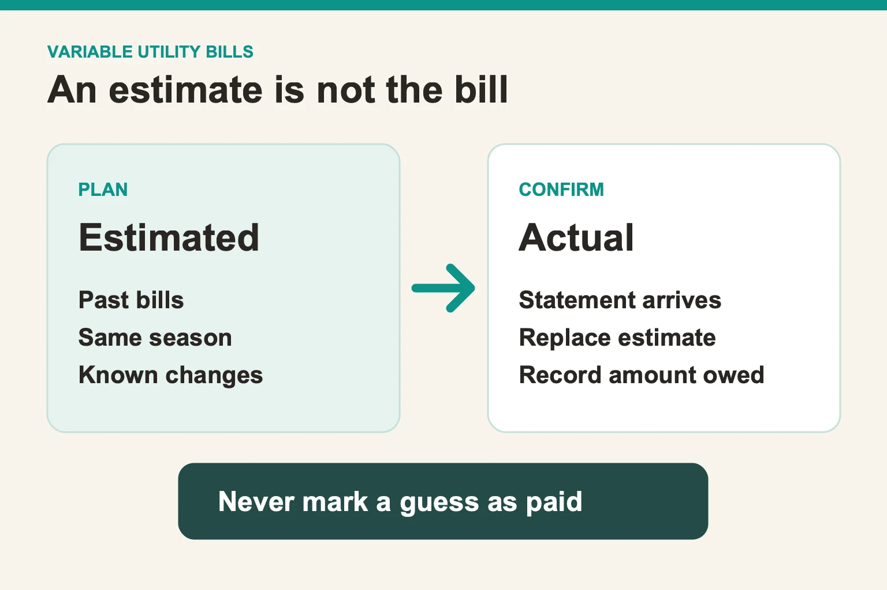

# How to estimate variable utility bills before the statement arrives

*Last updated: October 2026.*

Use an estimate to plan for a utility bill, then replace it with the actual amount when the statement arrives. Keep the two values visibly different. A recent bill, a bill from the same season last year, and any known rate or household changes can inform the estimate. None guarantees the next charge. The aim is to prepare enough cash and avoid presenting a guess as money already owed.

## Which past bill is the best starting point?

Choose a past statement that resembles the coming billing period. For electricity, a month with similar weather or household use may be more useful than the immediately previous month. For water, a recent leak, new household member, or travel period can make a simple average misleading. Record why you chose the comparison bill so you can revisit the estimate later.

The [Consumer Financial Protection Bureau's bill calendar](https://www.consumerfinance.gov/archive/blog/budget-help-manage-your-monthly-expenses-bill-calendar/) starts with the amount and due date for each bill. A variable bill adds one more field: whether the amount is estimated or confirmed. This small distinction lets you plan without claiming to know a charge the supplier has not issued.

| What you know | Practical estimate method | What could make it wrong |
| --- | --- | --- |
| Several comparable recent bills | Use a transparent average | Seasonal use or a rate change |
| Strong seasonal pattern | Compare the same period last year | Different weather or household size |
| New account with little history | Use the supplier's available estimate, clearly labeled | The estimate may not match your actual use |
| Supplier has issued a new statement | Use the confirmed statement amount | Check adjustments or disputed charges separately |

## How do you turn the estimate into a useful plan?

Record the bill's due date, your estimate, and the date you expect the statement. If you have three comparable bills of US$90, US$110, and US$100, their simple average is US$100. You might set aside more than that if the coming month is usually more expensive, but label the extra amount as a buffer. These figures only demonstrate the method.

Then check the calendar against your paydays. A bill can be affordable over a month and still arrive before the relevant paycheck. If that happens often, the [CFPB's budget worksheet guidance](https://www.consumerfinance.gov/archive/blog/budgeting-how-to-create-a-budget-and-stick-with-it/) suggests looking at income and bill timing together. Keep a note of when you will revisit the estimate, rather than letting it silently become the “actual” number.

## What should you do when the actual statement arrives?

Replace the estimate with the confirmed amount and note the difference. If the statement is higher, adjust the cash plan for this month; if lower, keep the surplus available for another variable month or return it to the household budget. Do not change the historical estimate without preserving that you originally planned with a different number. The gap tells you whether your method needs improvement.

HomeWeal's [feature page](/features) says unpaid variable bills display an estimate and a prompt to confirm the actual amount. Variable amount bills and the bill calendar are listed on Solo. This is a good fit if you want a recurring record without connecting a bank account. A sheet with separate “estimate” and “actual” columns can work just as well if you are willing to maintain it.

## How should roommates or partners share a changing bill?

Agree on the split rule before the final amount arrives. A household using HomeWeal's Family plan might choose equal shares or a custom percentage; another arrangement can be recorded manually if everyone accepts it. Decide whether each person contributes against an estimate first and settles the difference later, or waits until the actual statement. Write down the choice so nobody treats a provisional number as a debt.

HomeWeal's [shared bills page](/shared-bills) describes equal, custom, and proportional per-bill splits plus a settle-up tracker on the Family plan. Solo's variable bill record does not imply those Family features are available. If your household prefers a simple shared spreadsheet, add columns for the agreed rule, estimated shares, confirmed shares, and settlement date.

## What mistakes should you avoid?

Do not rely on one unusually cheap month, forget seasonal changes, or confuse usage with the final payable amount. A tariff change, fee, credit, or correction can affect a statement. Read the supplier's actual bill before marking it paid. If the charge looks wrong, use the supplier's dispute process rather than trying to resolve it through a budgeting app.

The useful routine is short: estimate, reserve, confirm, and compare. Start with the next utility due date and one comparable past statement. Add the estimate to your [household bill calendar](/features), then update it when the real statement arrives. The record becomes more useful each cycle because you can see where your assumptions were accurate and where they were not.
