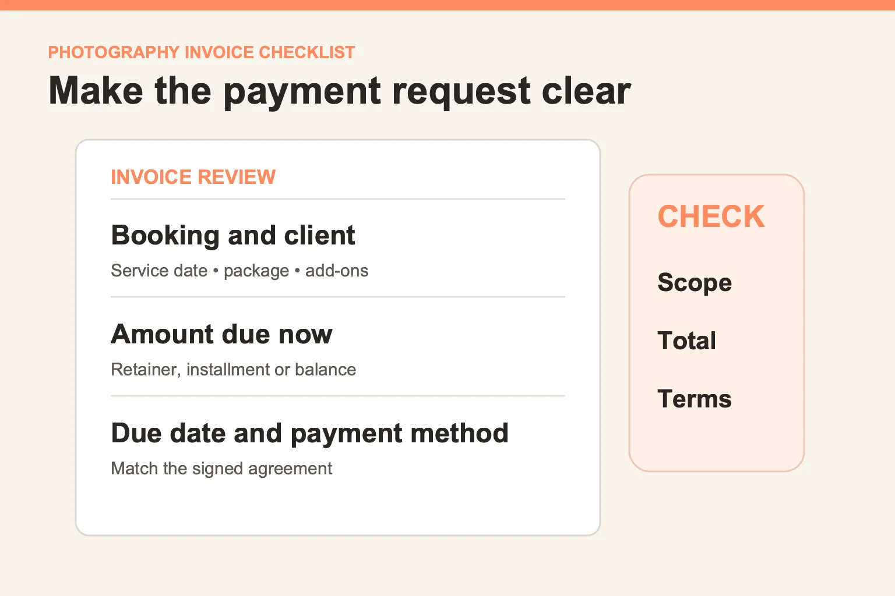

# Photography invoice checklist: what should you send a client?

*Last updated: October 2026.*

A useful photography invoice tells the client what they booked, what each item costs, when payment is due, and how to pay. It should match the signed agreement and make deposits, installments, and the remaining balance easy to reconcile. A branded PDF alone is not enough if the scope or due date is unclear. Use this checklist when a client moves from proposal to booking or when an approved add-on changes the total.

*AI-generated editorial scene; not a ShootMuse customer or product screen.*

## What belongs on a photography invoice?

Start with the agreed work, then make the payment request unambiguous. For a wedding, this may include coverage hours and an album. For portraits, it may be the session fee and an additional image purchase. The invoice should be specific enough that the client can match it to the contract without a phone call.

| Field | What the client should understand |
| --- | --- |
| Studio and client details | Who is billing and who is responsible for payment |
| Invoice number and issue date | Which request this is, especially if there are revisions |
| Session or event reference | Which booking the invoice covers |
| Line items | Package, hours, products, approved add-ons, and quantities |
| Total and amount due now | Whether the request is for a retainer, installment, or balance |
| Due date and payment method | The deadline and the route to payment |
| Terms or contract reference | Where to find cancellation, delivery, and other agreed terms |

*Before sending, compare the booking, amount due now, and payment terms with the agreement. A portrait version is supplied for mobile.*

Tax treatment depends on location and the transaction. Use the correct amount from your own records or accountant rather than copying a sample invoice's tax line. This article is a workflow checklist, not tax or legal advice.

## How do you connect the invoice to the contract?

The contract defines the commitment; the invoice requests a payment under it. Before sending, compare the names, service date, package description, products, and total against the signed version. If the client adds another hour or an album, record the change in the agreement or an approved addendum first, then invoice the new amount.

This review is particularly important when a quote changes after the original proposal. A client should never have to work out whether an invoice line silently replaced, duplicated, or added to the original package. ShootMuse's [invoicing feature page](/features/invoicing) describes branded invoices, line items, package breakdowns, PayPal payments, and invoice status tracking. Its [feature overview](/features) also describes the connected contract and booking workflow.

## How should a retainer and installments appear?

Separate the full booking value from the payment requested today. For example, if a studio and client agree on a US$2,000 package with a US$500 retainer, the first payment request should identify the retainer and show how it applies to the balance. Those numbers are an illustration, not ShootMuse pricing or a recommended policy.

Before you offer a schedule, decide when each payment is due and what happens if the event date changes. Put the policy in the agreement. ShootMuse lists PayPal payments, installment plans, and automated payment reminders on its [invoicing page](/features/invoicing). Its site describes basic invoicing on Starter and the PayPal payment and installment features on Professional and Studio, so check the [current plan comparison](/pricing) before building your process around a paid-plan tool. Standard PayPal processing fees can apply even though ShootMuse says it charges zero platform transaction fees on invoice payments.

## What is a good send-and-follow-up sequence?

The goal is a clear next step for the client and an accurate record for the studio.

1. Confirm the agreement and any approved changes.
2. Create the invoice with a descriptive booking reference and itemized amount.
3. Check the amount due now, deadline, and payment route.
4. Send the invoice with one short note explaining what happens after payment.
5. Record payment against the correct invoice and confirm receipt.
6. Follow up only when needed, using the agreed terms and a human review for exceptions.

Automated reminders can save work, but they should not continue when a client is disputing a charge or when the studio has agreed to an extension. Treat automation as a scheduled prompt for a conversation, not a replacement for judgment. ShootMuse's [plan comparison](/pricing) describes the additional workflow tools on Professional and Studio.

## What mistakes cause the most confusion?

An invoice with one generic “photography services” line often creates more questions than it saves typing. So does asking for a retainer without showing the full agreed amount and balance. Another avoidable error is using a payment due date that conflicts with the contract. Check the details before pressing send, especially on a copied invoice.

If you have only occasional bookings, a simple template and manual tracking may be enough. If you regularly manage proposals, contracts, installment dates, and galleries for the same clients, keeping the records connected can reduce the number of handoffs. See [what a photography CRM does](/blog/what-is-a-photography-crm) and test the [ShootMuse invoicing workflow](/features/invoicing) against one real booking before changing your whole process.
