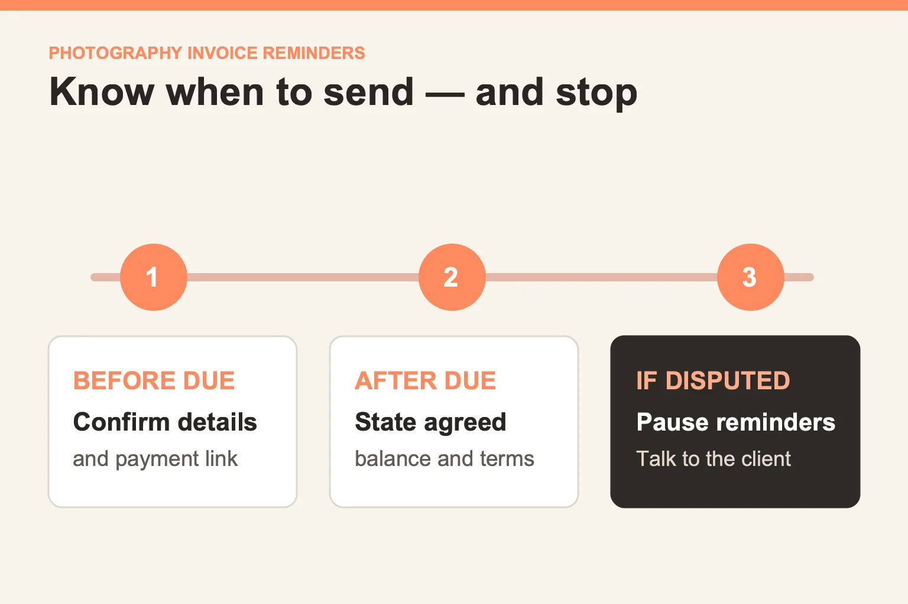

# Photography invoice reminder email templates for late and upcoming payments

*Last updated: October 2026.*

A photography invoice reminder should identify the booking and invoice, state the amount and agreed due date, make payment easy to find, and give the client a way to correct a mistake. The tone can stay calm even after the date passes. Check the invoice and contract before sending: a reminder about a paid, changed, or disputed balance creates more work than it saves.

## What should you verify before sending a reminder?

Open the actual client record, not a generic mailing list. Confirm the invoice number, amount still owed, due date, payment status, and any recent conversation. A client may have paid through a method that has not yet appeared in your dashboard, arranged an extension, or raised a question about the scope. Pause the reminder while those facts are unresolved.

Use this decision table to choose the next action:

| What the record shows | Next action |
| --- | --- |
| Due soon and no payment recorded | Send a short heads-up with the invoice link and date |
| Past due, no reply or exception | Send one clear, courteous overdue note |
| Partial payment or agreed extension | State only the corrected balance and agreed date |
| Client disputes the charge | Stop the sequence and answer the issue personally |
| Payment recorded | Stop reminders and confirm receipt if appropriate |

This is a workflow example, not a required cadence. Use the notice periods in your own signed agreement and adapt to the relationship. ShootMuse's [invoicing page](/features/invoicing) describes invoice status tracking and automated payment reminders; its [current pricing page](/pricing) places PayPal payments and the fuller payment workflow on Professional and Studio. Basic invoice creation and sending are listed on Starter. Check the current plan before promising an automated sequence to a client.

## What can you write before the due date?

A pre-due note should help the client find the invoice and avoid sounding as though payment is already late. Send it only if the date and amount are correct.

> Subject: Your photography invoice is due soon
>
> Hi,
>
> A quick note that the invoice for your photography booking is due on the date shown in the invoice. You can review the line items and use the payment link in the original invoice. If you have already paid, thank you; please disregard this note while the payment is recorded. If any detail looks different from our agreement, reply here and I will check it before the due date.
>
> Thank you.

For a real send, add the client's name, the session or event date, invoice number, exact amount due, due date, and a working payment link. A template without those details is incomplete; a template that inserts the wrong details is worse. Review the final message as the client will see it, including on a phone.

## What can you write when an invoice is overdue?

The first overdue note should be direct and leave room for a simple explanation. Do not imply the client has ignored you if this is the first message after the deadline.

> Subject: Checking on your photography invoice
>
> Hi,
>
> I am following up on the invoice for your photography booking. The agreed due date has passed, and I do not yet see the payment recorded. The original invoice has the itemized balance and payment link. If you have already sent payment, or if something on the invoice needs correcting, please reply so I can check the record before taking another step.
>
> Thank you.

For a later reminder, refer to the prior note and the contractual terms without inventing a penalty or deadline. If the balance affects a future booking date or delivery, verify the contract and speak to the client personally before making a consequential statement. Legal and tax consequences vary by agreement and location; this guide does not set them for your studio.

## What if the client has a genuine question or needs more time?

Move out of the automatic sequence. An invoice reminder is useful only while the amount and due date are settled. If a client says an add-on was never approved, check the proposal, contract, and change history. If the client requests an extension, record the new date only after you agree to it; then update the invoice or your payment record to match. Do not keep sending the old template against a new arrangement.

An exception message can be short:

> Thanks for flagging this. I have paused the payment reminders while I review the invoice against our agreement. I will send you the corrected balance or a clear explanation after that review.

That wording makes a concrete commitment without assuming who is right. Keep any personal circumstances out of broad automation rules and treat the conversation with care.

## How do you set up a reminder sequence you can trust?

Define the trigger, stop condition, and human owner for each message before switching it on. A practical setup is:

1. Write down the invoice state that allows each reminder to send.
2. Identify the exact client and invoice fields the message must use.
3. Stop or pause on payment, dispute, extension, cancellation, or a manual hold.
4. Send a test invoice to yourself and read each reminder on a phone.
5. Check the client record after the test to confirm the correct status and no duplicate sends.
6. Review exceptions regularly; automation should surface work for a person, not bury it.

ShootMuse describes automated reminders and installment plans on its [invoicing page](/features/invoicing). It also says it charges zero platform transaction fees on invoice payments, while standard PayPal processing fees apply; that fee statement does not change the client's agreed balance. If you are still designing the invoice itself, review the [current invoicing features](/features/invoicing) and compare them with your agreement. An accurate invoice is the foundation of a respectful reminder.
